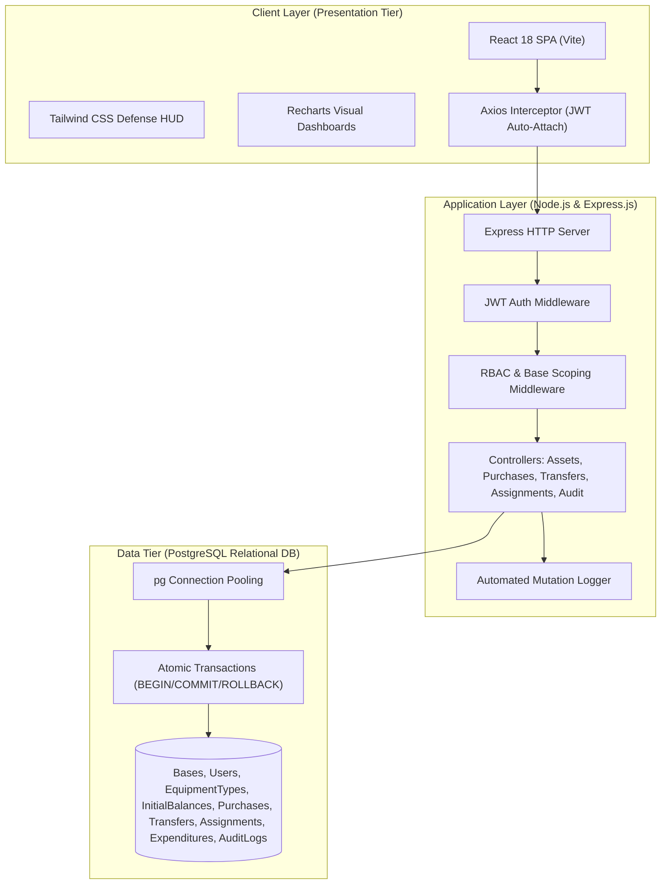
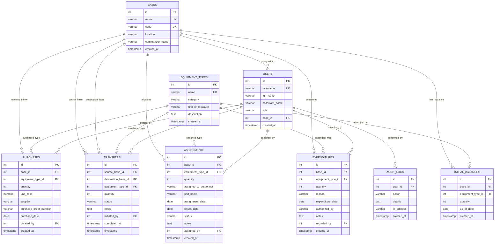

# KRISTALLBALL DEFENSE SYSTEMS
## Enterprise Military Asset Management System
### Comprehensive Technical Documentation & Architecture Specification Report

---

## 1. Executive Summary & Project Objective

The **Kristallball Military Asset Management System** is an enterprise-grade defense logistics platform designed to provide real-time, tamper-proof tracking of critical military equipment across multiple distributed bases.

### 1.1 Core Problems Solved
- **Inventory Discrepancy & Duplication:** Replaces error-prone manual spreadsheets with dynamic database calculus guaranteeing mathematical consistency across opening balances, net movements, assignments, expenditures, and closing balances.
- **Supply Chain Leakage & Transfer Chaos:** Guarantees that assets in transit are tracked atomically using PostgreSQL database transactions (`BEGIN...COMMIT / ROLLBACK`), ensuring equipment cannot be simultaneously deducted and lost in transit.
- **Insider Threat & Privilege Creep:** Enforces strict Role-Based Access Control (RBAC) preventing base commanders from snooping or modifying other bases, while granting logistics officers supply-chain authority and headquarters global oversight.
- **Regulatory Accountability & Auditability:** Automatically generates an immutable audit record for every mutation across the system.

---

## 2. Core Mathematical Reconciliation Model

Inventory reconciliation across any tactical theater or specified temporal range follows strict defense accounting formulas:

$$\text{Closing Balance} = \text{Opening Balance} + \text{Net Movement} - \text{Assigned} - \text{Expended}$$

$$\text{Net Movement} = \text{Purchases} + \text{Transfers In} - \text{Transfers Out}$$

### Mathematical Component Definitions
1. **Opening Balance ($\text{OB}$):** Baseline on-hand physical inventory established in `initial_balances` prior to operations.
2. **Purchases ($\text{P}$):** Direct stock inflow acquired from defense arsenals and manufacturers.
3. **Transfers In ($\text{TI}$):** Assets safely received from external tactical bases where transfer status is marked as `COMPLETED`.
4. **Transfers Out ($\text{TO}$):** Assets dispatched from the base to reinforce external commands where transfer status is `COMPLETED`.
5. **Assigned ($\text{A}$):** Weapons and tactical vehicles actively issued to soldiers, combat squads, or battalions (`status = 'ACTIVE'`).
6. **Expended ($\text{E}$):** Depleted stock (such as live-fire training rounds, combat expenditures, or decommissioned matériel).
7. **Closing Balance ($\text{CB}$):** Reconciled physical stock ready for active deployment in armories.

---

## 3. System Architecture & Component Design

The platform uses a decoupled three-tier enterprise client-server architecture:



---

## 4. Entity-Relationship (ER) Schema Diagram



---

## 5. Granular Role-Based Access Control (RBAC) Architecture

### 5.1 Roles Defined
1. **HQ Admin (`ADMIN`):** Unrestricted access across all operational bases, theater aggregation, base comparison metrics, procurement, transfers, and complete audit logging.
2. **Base Commander (`BASE_COMMANDER`):** Automatically scoped to their assigned base armory. Cannot inspect or initiate transactions involving other bases. Can assign equipment to their unit personnel and record munitions expenditure.
3. **Logistics Officer (`LOGISTICS_OFFICER`):** Dedicated supply-chain controller focused on procurement inflows and cross-base transfers.

### 5.2 RBAC Authorization Matrix

| Capability / API Route | HTTP Method | ADMIN | BASE_COMMANDER | LOGISTICS_OFFICER |
| :--- | :---: | :---: | :---: | :---: |
| **Authentication Login** | `POST /api/auth/login` | Public | Public | Public |
| **Session Profile** | `GET /api/auth/me` | Authenticated | Authenticated | Authenticated |
| **Theater Asset Metrics** | `GET /api/assets/metrics` | All Bases | Auto-Scoped | All Bases |
| **Itemized Breakdown** | `GET /api/assets/breakdown` | All Bases | Auto-Scoped | All Bases |
| **Category Statistics** | `GET /api/assets/categories` | All Bases | Auto-Scoped | All Bases |
| **Cross-Base Comparison** | `GET /api/assets/base-comparison` | ✅ Authorized | ❌ Denied (403) | ✅ Authorized |
| **View Purchases** | `GET /api/purchases` | All Bases | Auto-Scoped | All Bases |
| **Log New Purchase** | `POST /api/purchases` | ✅ Global | ✅ Own Base | ✅ Global |
| **View Transfers** | `GET /api/transfers` | All Transfers | Scoped (Src/Dst) | All Transfers |
| **Dispatch Transfer** | `POST /api/transfers` | ✅ Any Base | ✅ Src = Own Base | ✅ Any Base |
| **Update Transfer Status** | `PATCH /api/transfers/:id/status`| ✅ Authorized | ✅ Own Base Dst | ✅ Authorized |
| **View Assignments** | `GET /api/assignments` | All Bases | Auto-Scoped | All Bases |
| **Create Assignment** | `POST /api/assignments` | ✅ Authorized | ✅ Own Base | ❌ Denied (403) |
| **Return Assignment** | `PATCH /api/assignments/:id/return` | ✅ Authorized | ✅ Own Base | ❌ Denied (403) |
| **View Expenditures** | `GET /api/assignments/expenditures` | All Bases | Auto-Scoped | All Bases |
| **Log Expenditure** | `POST /api/assignments/expenditures` | ✅ Authorized | ✅ Own Base | ✅ Authorized |
| **View Audit Trail** | `GET /api/audit-logs` | ✅ Global | ✅ Authorized | ❌ Denied (403) |

---

## 6. Atomic Database Transactions & Stock Integrity

### 6.1 Transaction Safety Pattern
When a transfer is initiated, the system must guarantee that:
1. The source base has sufficient available stock (`available_stock >= requested_transfer`).
2. Source and destination bases are not identical.
3. The transfer record is inserted and the audit log is recorded atomically.
4. If an unexpected failure occurs at any stage, the entire transaction is rolled back (`ROLLBACK`).

```javascript
// Transfer execution snippet
const client = await db.getClient();
try {
  await client.query('BEGIN'); // Start atomic block

  // 1. Check source stock
  const stockRes = await client.query(stockQuery, [sourceBaseId, equipmentTypeId]);
  if (stockRes.rows[0].current_available_stock < quantity) {
    throw new Error('Insufficient inventory at source base');
  }

  // 2. Insert transfer record
  const transferRes = await client.query(insertQuery, [...]);

  // 3. Insert audit log
  await client.query(auditQuery, [userId, `Transfer #${transferRes.rows[0].id} executed`]);

  await client.query('COMMIT'); // Persist atomically
} catch (error) {
  await client.query('ROLLBACK'); // Restore initial state on any error
  throw error;
} finally {
  client.release();
}
```

---

## 7. Sample Test Credentials Template

| Role | Username | Password | Base Assigned | Operational Authorization Scope |
| :--- | :--- | :--- | :--- | :--- |
| **HQ Admin** | `admin_user` | `AdminPass123!` | All Bases (Global) | Unrestricted global access across all bases, procurement, transfers, and audit logs. |
| **Base Commander Alpha** | `commander_alpha` | `CommandPass123!` | Fort Alpha (Base #1) | Auto-scoped to Fort Alpha. Cannot view or transfer inventory belonging to other bases. |
| **Base Commander Bravo** | `commander_bravo` | `CommandPass123!` | Fort Bravo (Base #2) | Auto-scoped to Fort Bravo armory management. |
| **Logistics Officer** | `logistics_officer` | `LogisticsPass123!` | Base #1 / Global Ops | Supply chain management, cross-base movements, and procurement logging. |

---

## 8. Detailed API Endpoint Listing

### 8.1 Authentication
- `POST /api/auth/login`
  - Body: `{ "username": "admin_user", "password": "AdminPass123!" }`
  - Response (200): `{ "token": "JWT...", "user": { "id": 1, "username": "...", "role": "ADMIN", ... } }`
- `GET /api/auth/me`
  - Headers: `Authorization: Bearer <token>`
  - Response (200): User profile with base details.

### 8.2 Asset Calculations
- `GET /api/assets/metrics?baseId=1&category=WEAPON&startDate=2026-01-01`
  - Response (200): `{ "openingBalance": 1180, "purchases": 105, "transfersIn": 20, "transfersOut": 32, "netMovement": 93, "assigned": 51, "expended": 27, "closingBalance": 1195, ... }`
- `GET /api/assets/breakdown`
  - Itemized balance table per equipment type.
- `GET /api/assets/categories`
  - Category distribution for visual charts.
- `GET /api/assets/base-comparison` (Admin Only)
  - Side-by-side comparison across all 4 tactical bases.

### 8.3 Purchases
- `GET /api/purchases`
  - Filterable by `baseId`, `equipmentTypeId`, `search`, and date range.
- `POST /api/purchases`
  - Body: `{ "baseId": 1, "equipmentTypeId": 1, "quantity": 25, "unitCost": 1200.0, "supplier": "Colt Defense", "purchaseOrderNumber": "PO-2026-0999" }`

### 8.4 Transfers
- `GET /api/transfers`
  - Returns cross-base movements.
- `POST /api/transfers`
  - Body: `{ "sourceBaseId": 1, "destinationBaseId": 4, "equipmentTypeId": 1, "quantity": 10, "status": "COMPLETED", "notes": "Perimeter reinforcement" }`
- `PATCH /api/transfers/:id/status`
  - Body: `{ "status": "COMPLETED" }`

### 8.5 Assignments & Expenditures
- `GET /api/assignments`
  - Personnel allocations.
- `POST /api/assignments`
  - Body: `{ "baseId": 1, "equipmentTypeId": 1, "quantity": 10, "assignedToPersonnel": "Sgt. Miller", "unitName": "Alpha Platoon" }`
- `PATCH /api/assignments/:id/return`
  - Marks active assignment as returned.
- `GET /api/assignments/expenditures`
  - Consumed munitions logs.
- `POST /api/assignments/expenditures`
  - Body: `{ "baseId": 1, "equipmentTypeId": 7, "quantity": 10, "reason": "TRAINING", "authorizedBy": "Col. Vance" }`

### 8.6 System Audit Logs
- `GET /api/audit-logs`
  - Complete security trail with filter parameters (`action`, `userId`, `startDate`, `endDate`).

---

## 9. Video Walkthrough Presentation Script (3-5 Minutes)

### Target Duration: 4 Minutes

#### 0:00 - 0:45 | Architecture & Mission Overview
- "Hello. Today I am presenting Kristallball, an enterprise-grade Military Asset Management System. In military logistics, tracking high-value assets like M1A2 Abrams tanks, M4A1 carbines, and munitions across bases requires transactional integrity, absolute RBAC isolation, and real-time reconciliation."
- "The core mathematical model ensures that at any moment: Closing Balance equals Opening Balance plus Net Movement minus Assigned minus Expended, where Net Movement equals Purchases plus Transfers In minus Transfers Out."

#### 0:45 - 1:45 | Live Functional Demo: Admin & Real-Time Dashboard
- "Logging in with our one-click credential as General Arthur, the HQ Admin. Notice our top bar displays 'GLOBAL THEATER - ALL BASES'."
- "On the dashboard, we see five key metrics: Opening Balance, Net Movement, Assigned to Units, Expended Stock, and Closing Balance."
- "Clicking the Net Movement card opens the modal dialog with the exact mathematical breakdown: Purchases plus Transfers In minus Transfers Out, plus alerts on in-transit convoys."
- "Below, Recharts displays category distribution across Weapons, Vehicles, and Ammunition, and cross-base comparisons across Fort Alpha, Fort Bravo, Naval Station Echo, and FOB Zulu."

#### 1:45 - 2:45 | Cross-Base Transfers & Atomic Transactions
- "Next, navigating to Asset Transfers. We dispatch a transfer of 10 M4A1 Carbines from Fort Alpha to FOB Zulu."
- "Behind the scenes, this executes an atomic PostgreSQL transaction with `BEGIN` and `COMMIT`. The system verifies in real time that Fort Alpha has at least 10 available units. If not, it rejects with an informative error."
- "Once committed, the audit log table records the mutation with timestamp, IP address, and operator ID."

#### 2:45 - 3:30 | Strict RBAC Demonstration (Base Commander Isolation)
- "Now let's test Role-Based Access Control. We sign out and log in as Base Commander Col. Vance (`commander_alpha`)."
- "Notice immediately: The assigned base indicates 'Fort Alpha (FA-01)'. The base selector is locked to Fort Alpha. The Commander cannot view Fort Bravo's inventory."
- "If the Commander attempts to access the Admin-only base comparison route or mutate another base's armory, our `enforceBaseScope` and `authorizeRoles` middlewares return HTTP 403 Forbidden."

#### 3:30 - 4:00 | Audit Logs & Summary
- "Finally, visiting System Audit Logs. Every operation—login, purchase, transfer, assignment, expenditure—is indexed and chronologically recorded."
- "With PostgreSQL ACID transactions, full RBAC isolation, and mathematical reconciliation, Kristallball provides complete operational defense visibility."

---

## 10. Verification & Test Suite Results

The automated API test suite (`npm run test`) runs in-process to verify:
1. `GET /api/health` -> HTTP 200 `ONLINE`.
2. `POST /api/auth/login` for Admin -> Generates signed JWT.
3. `POST /api/auth/login` for Commander -> Scopes to Base #1.
4. Mathematical verification: Global closing balance reconciles identically (`Opening (3269) + Net Move (147) - Assigned (89) - Expended (59) = Closing (3268)`).
5. Scoped verification: Commander's base reconciles identically (`Opening (1180) + Net Move (93) - Assigned (51) - Expended (27) = Closing (1195)`).
6. Cross-base transfer integrity verified.
7. RBAC unauthorized access attempt -> HTTP 403 Forbidden verified.

---
*Kristallball Defense Logistics Systems — Verification Status: ALL SYSTEMS OPERATIONAL*
